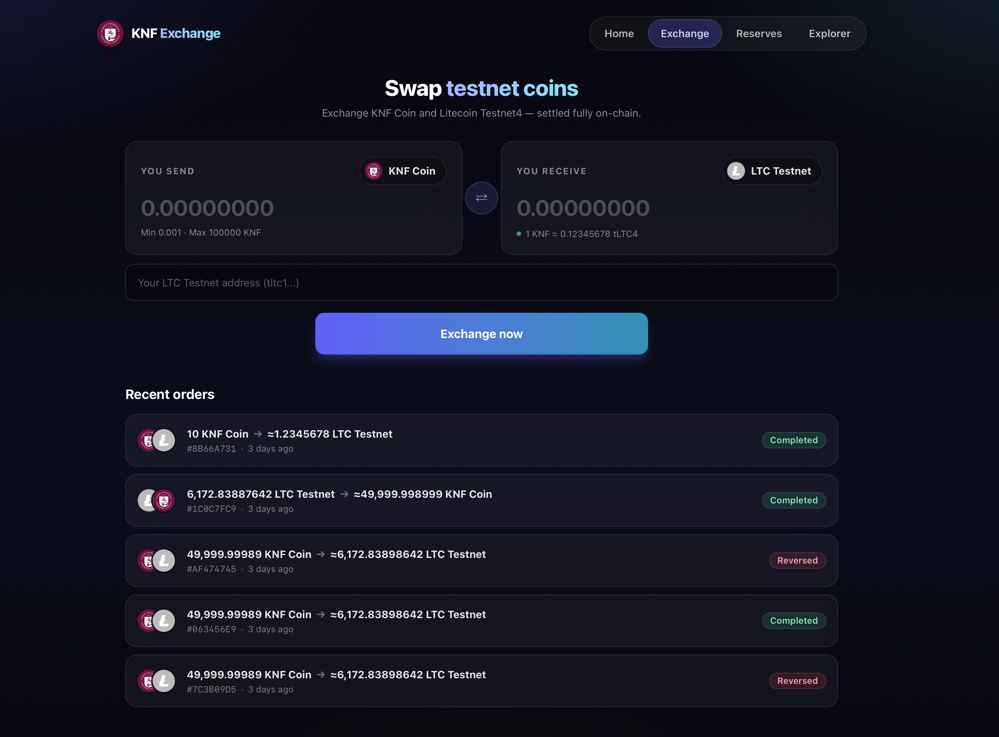
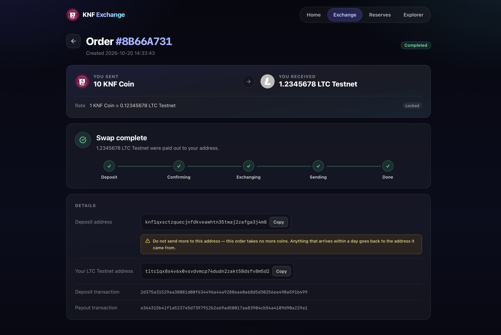
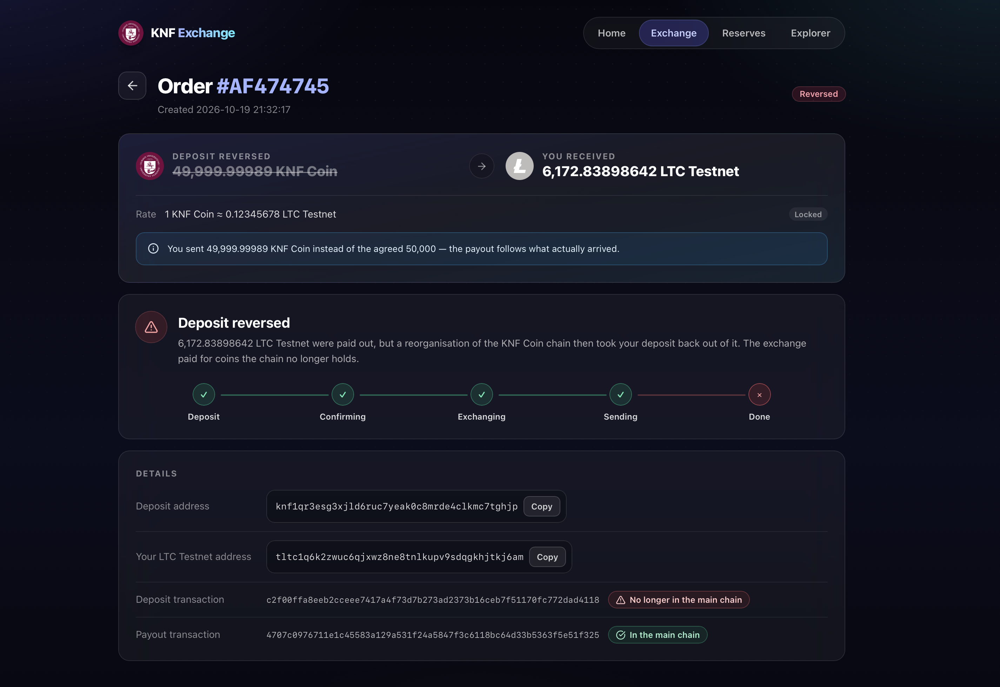

# KNF Coin Exchange

Swap KNF Coin and Litecoin Testnet4 the way a real crypto exchange does it,
fully on-chain. Pick an amount, send your coins to the order's own deposit
address, and watch the order move live: the deposit confirming, the rate
locking, the payout leaving the exchange's reserve for your wallet. When
something goes wrong, like a reserve running dry or a deposit taken back by a
reorganisation, the exchange shows that too.

Built for blockchain classes at Vilnius University Kaunas Faculty.



<br/>

## How a swap plays out

1. **Order.** Choose what you send and what you get, paste your receiving
   address and press *Exchange now*. The order gets a deposit address of its
   own and 30 minutes to be paid.
2. **Pay.** Send the coins from any wallet. Sent a little more or less than
   agreed? The payout follows what actually arrived.
3. **Confirm.** Once the deposit has 2 confirmations the rate locks and the
   payout goes out from the exchange's reserve. The order shows *Swap
   complete* right away while the payout confirms on its own chain.



When a swap can't go through, because the reserve can't cover it or the
payout would be too small to send, your coins go back to the address they
came from. An order the reserve could never cover is refused before you pay.

The exchange keeps watching the chain after it pays. If a reorganisation
takes back a deposit it has already paid for, the order turns *Reversed* and
marks the transaction that left the chain. To stage one yourself, run a 51%
attack on KNF Coin with [reorg-tool](https://github.com/kaunofakultetas/reorg-tool).



<br/>

## Run it yourself

All you need is Docker with Compose, plus some testnet coins for the
exchange's reserves.

```sh
cp docker-compose.sample.yml docker-compose.yml
# replace GUI_PASSWORD_HERE with the password the site will ask for
./runUpdateThisStack.sh
```

Then open `http://localhost/`, log in, and top up both reserves from the
*Reserves* page: the exchange can only pay out what its reserves hold. On the
first start the KNF Coin node takes a while to download the chain before the
explorer can show it.

The first run writes the exchange's wallet key to `.env`. Every deposit and
reserve address comes from that key, so keep a copy somewhere safe.

Chains, confirmation counts and Electrum servers are set in
`_CONFIG/coins.py`. The sample points at the faculty's servers. If you run
your own, start their nodes with `-txindex=1`: refunds need it to find out
who sent a deposit.

<br/>

## What's inside

| Service | What it does |
|---|---|
| `knfexchange-endpoint` | Caddy on port 80: the password gate, then `/api` to the backend, `/explorer` and `/dbgate` to their tools, everything else to the page |
| `knfexchange-login` | The login page shown before the password is given |
| `knfexchange-vite` | The React page: the swap form, the order pages and the reserves |
| `knfexchange-backend` | Flask API and the order worker: watches deposits, pays out, sends coins back, keeps the orders in SQLite |
| `knfexchange-explorer` | KNF Coin block explorer at `/explorer` |
| `knfexchange-fullnode` | KNF Coin full node the explorer reads |
| `knfexchange-dbgate` | Database browser at `/dbgate` (user `admin`, password in `.env`) |

The orders database and the KNF Coin chain live in `_DATA/`.

<br/>

## Working on it

The sample runs the published Docker Hub images. To change the code, switch
`knfexchange-vite` and `knfexchange-backend` to the self-built,
source-mounted variants commented in `docker-compose.sample.yml`. The page
then reloads live; the backend picks up changes when you restart it. Each
side has its own test suite that runs in a throwaway container:
`backend/runTests.sh` and `vite/runTests.sh`.
